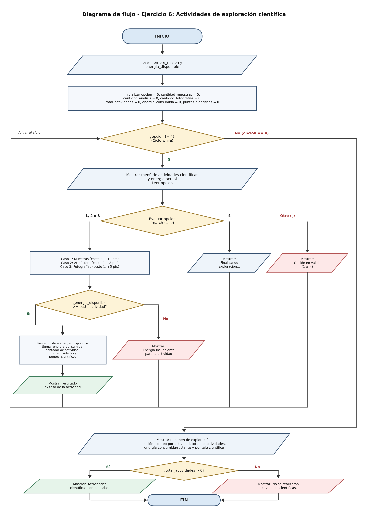
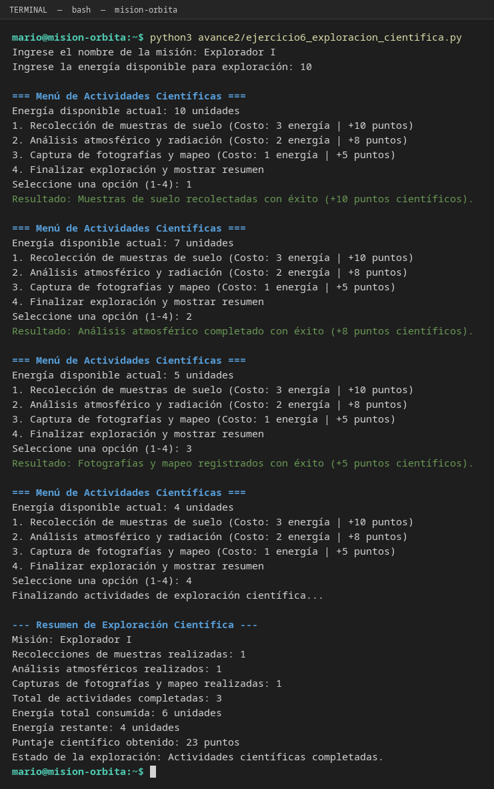
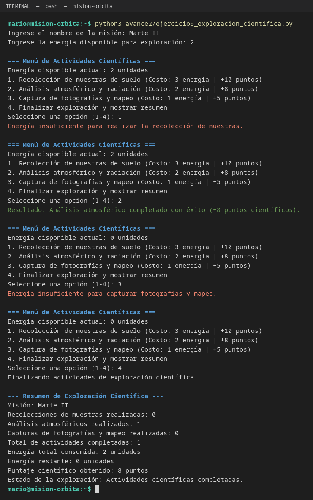
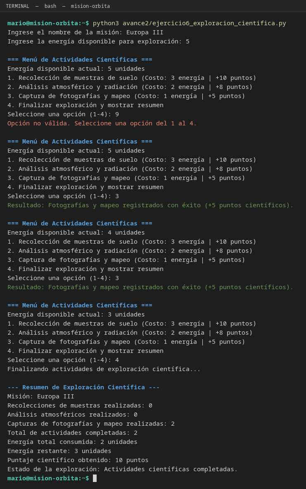
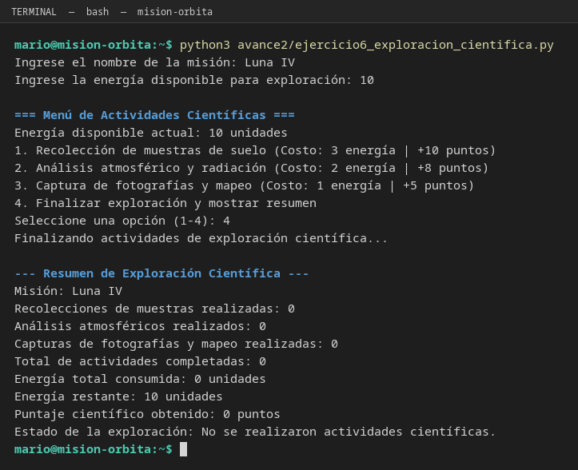

# Ejercicio 7. Actividades de exploración científica

**Misión Órbita | Avance 2**  
**Curso:** SOFT-01 Principios de Programación 1 - Sección SCV0  
**Archivo fuente:** `avance2/ejercicio6_exploracion_cientifica.py`

---

## 1. Objetivo

Permitir a la tripulación seleccionar y ejecutar actividades de exploración científica mediante un menú interactivo repetitivo, evaluando las opciones con `match-case`, controlando la energía disponible y registrando el total de actividades completadas junto con sus resultados finales.

---

## 2. Análisis de entradas, proceso y salidas

**Tabla 1**  
*Análisis de entradas, proceso y salidas del ejercicio 6*

| Elemento | Descripción |
| :--- | :--- |
| **Entradas** | Nombre de la misión; energía disponible para exploración; opción seleccionada del menú científico (en cada iteración del ciclo). |
| **Proceso** | Repetir el menú mediante un ciclo `while` mientras la opción sea distinta de 4; evaluar la opción con `match-case`; verificar si existe energía suficiente antes de realizar cada actividad; descontar la energía consumida y actualizar contadores y puntaje científico. |
| **Salidas** | Menú interactivo con energía actual; mensaje de confirmación o energía insuficiente por cada actividad; mensaje de error ante opción inválida; resumen final con conteo por actividad, total de actividades, energía consumida, energía restante, puntaje científico y estado final de la exploración. |

---

## 3. Menú de actividades y reglas de control

**Tabla 2**  
*Opciones del menú de actividades científicas*

| Opción | Actividad científica | Consumo de energía | Puntaje obtenido |
| :---: | :--- | :---: | :---: |
| 1 | Recolección de muestras de suelo | 3 unidades | +10 puntos |
| 2 | Análisis atmosférico y radiación | 2 unidades | +8 puntos |
| 3 | Captura de fotografías y mapeo | 1 unidad | +5 puntos |
| 4 | Finalizar exploración y mostrar resumen | 0 unidades | Finaliza el ciclo |

- Cada actividad científica solo se ejecuta si `energia_disponible >= costo` de la actividad seleccionada.
- Si no hay suficiente energía, no se descuentan recursos ni se suman resultados, y el programa muestra un aviso.
- Si se ingresa un número fuera del rango 1 a 4, el bloque `case _:` muestra un mensaje de opción no válida y vuelve a mostrar el menú.

---

## 4. Convención de nombres

Siguiendo la convención definida en el proyecto:
- Los identificadores de **variables** se escriben en minúsculas con guion bajo (`nombre_mision`, `energia_disponible`, `puntos_cientificos`).
- Las **constantes** se escriben en MAYÚSCULAS CON GUION BAJO (`OPCION_SALIR`, `COSTO_MUESTRAS`, `PUNTOS_MUESTRAS`).
- Los títulos y descripciones se redactan con espacios normales.

---

## 5. Tabla de variables y constantes

**Tabla 3**  
*Variables y constantes del ejercicio 6*

| Identificador | Tipo | Clasificación | Valor inicial / restricción | Descripción |
| :--- | :---: | :--- | :--- | :--- |
| `OPCION_SALIR` | `int` | Constante | `4` | Opción del menú para finalizar la exploración científica. |
| `COSTO_MUESTRAS` | `int` | Constante | `3` | Unidades de energía requeridas para recolectar muestras de suelo. |
| `COSTO_ATMOSFERA` | `int` | Constante | `2` | Unidades de energía requeridas para análisis atmosférico y radiación. |
| `COSTO_FOTOGRAFIAS` | `int` | Constante | `1` | Unidades de energía requeridas para captura de fotografías y mapeo. |
| `PUNTOS_MUESTRAS` | `int` | Constante | `10` | Puntaje científico otorgado por cada recolección de muestras. |
| `PUNTOS_ATMOSFERA` | `int` | Constante | `8` | Puntaje científico otorgado por cada análisis atmosférico. |
| `PUNTOS_FOTOGRAFIAS` | `int` | Constante | `5` | Puntaje científico otorgado por cada captura de fotografías y mapeo. |
| `nombre_mision` | `str` | Entrada / salida | Texto | Nombre asignado a la misión espacial. |
| `energia_disponible` | `int` | Entrada / intermedia / salida | Entero no negativo | Energía disponible para exploración; se actualiza al realizar actividades. |
| `opcion` | `int` | Entrada / control | `0` inicial (`1`, `2`, `3`, `4` u otro) | Opción elegida en el menú; controla el ciclo `while` y el `match-case`. |
| `cantidad_muestras` | `int` | Intermedia / salida | `0` inicial | Cantidad de recolecciones de muestras completadas. |
| `cantidad_analisis` | `int` | Intermedia / salida | `0` inicial | Cantidad de análisis atmosféricos completados. |
| `cantidad_fotografias` | `int` | Intermedia / salida | `0` inicial | Cantidad de capturas de fotografías y mapeo completadas. |
| `total_actividades` | `int` | Intermedia / salida | `0` inicial | Total acumulado de actividades científicas completadas. |
| `energia_consumida` | `int` | Intermedia / salida | `0` inicial | Total acumulado de unidades de energía consumidas. |
| `puntos_cientificos` | `int` | Intermedia / salida | `0` inicial | Total acumulado de puntos científicos obtenidos. |

---

## 6. Mensajes del programa

**Tabla 4**  
*Mensajes del programa del ejercicio 6*

| Condición | Mensaje |
| :--- | :--- |
| Opción 1 con energía suficiente | `Resultado: Muestras de suelo recolectadas con éxito (+10 puntos científicos).` |
| Opción 2 con energía suficiente | `Resultado: Análisis atmosférico completado con éxito (+8 puntos científicos).` |
| Opción 3 con energía suficiente | `Resultado: Fotografías y mapeo registrados con éxito (+5 puntos científicos).` |
| Energía insuficiente (opciones 1, 2 o 3) | `Energía insuficiente para realizar ...` (según la actividad elegida). |
| Opción 4 (Salir) | `Finalizando actividades de exploración científica...` |
| Opción fuera de 1–4 (`case _:`) | `Opción no válida. Seleccione una opción del 1 al 4.` |
| Al finalizar con `total_actividades > 0` | `Estado de la exploración: Actividades científicas completadas.` |
| Al finalizar con `total_actividades == 0` | `Estado de la exploración: No se realizaron actividades científicas.` |

---

## 7. Diagrama de flujo

*Nota: los óvalos representan inicio y fin; los paralelogramos, entradas y salidas; los rectángulos, procesos; y los rombos, decisiones y estructuras de control (`while`, `match-case` e `if`).*

---

## 8. Casos de prueba y evidencias

### CP-06-01 — Ejecución de las tres actividades con energía suficiente

**Tabla 5**  
*Caso de prueba CP-06-01 del ejercicio 6*

| Campo | Contenido |
| :--- | :--- |
| **ID** | CP-06-01 |
| **Ejercicio** | Ejercicio 6 |
| **Escenario** | Ejecución de las tres actividades científicas con energía suficiente |
| **Datos de entrada** | `nombre_mision = Explorador I`; `energia_disponible = 10`; opciones: `1`, `2`, `3`, `4` |
| **Resultado esperado** | Muestras: 1; Análisis: 1; Fotografías: 1; Total actividades: 3; Energía consumida: 6; Energía restante: 4; Puntaje científico: 23; Estado: Actividades científicas completadas. |
| **Resultado obtenido** | Igual al esperado |
| **Estado** | Aprobado |

---

### CP-06-02 — Energía insuficiente y selección de actividad alternativa

**Tabla 6**  
*Caso de prueba CP-06-02 del ejercicio 6*

| Campo | Contenido |
| :--- | :--- |
| **ID** | CP-06-02 |
| **Ejercicio** | Ejercicio 6 |
| **Escenario** | Energía insuficiente para la opción 1, realización de opción 2 y agotamiento de energía para opción 3 |
| **Datos de entrada** | `nombre_mision = Marte II`; `energia_disponible = 2`; opciones: `1`, `2`, `3`, `4` |
| **Resultado esperado** | Rechaza opción 1 por falta de energía; ejecuta opción 2 (+8 puntos, energía queda en 0); rechaza opción 3 por falta de energía. Total actividades: 1; Energía consumida: 2; Energía restante: 0; Puntaje científico: 8; Estado: Actividades científicas completadas. |
| **Resultado obtenido** | Igual al esperado |
| **Estado** | Aprobado |

---

### CP-06-03 — Opción inválida y repetición de una misma actividad

**Tabla 7**  
*Caso de prueba CP-06-03 del ejercicio 6*

| Campo | Contenido |
| :--- | :--- |
| **ID** | CP-06-03 |
| **Ejercicio** | Ejercicio 6 |
| **Escenario** | Ingreso de opción inválida (`9`) y ejecución repetida de la opción `3` |
| **Datos de entrada** | `nombre_mision = Europa III`; `energia_disponible = 5`; opciones: `9`, `3`, `3`, `4` |
| **Resultado esperado** | Muestra mensaje de opción no válida para `9`; ejecuta dos capturas de fotografías. Muestras: 0; Análisis: 0; Fotografías: 2; Total actividades: 2; Energía consumida: 2; Energía restante: 3; Puntaje científico: 10; Estado: Actividades científicas completadas. |
| **Resultado obtenido** | Igual al esperado |
| **Estado** | Aprobado |

---

### CP-06-04 — Finalización inmediata sin realizar actividades

**Tabla 8**  
*Caso de prueba CP-06-04 del ejercicio 6*

| Campo | Contenido |
| :--- | :--- |
| **ID** | CP-06-04 |
| **Ejercicio** | Ejercicio 6 |
| **Escenario** | El usuario finaliza la exploración en la primera iteración del menú |
| **Datos de entrada** | `nombre_mision = Luna IV`; `energia_disponible = 10`; opción: `4` |
| **Resultado esperado** | Finaliza sin realizar actividades. Total actividades: 0; Energía consumida: 0; Energía restante: 10; Puntaje científico: 0; Estado: No se realizaron actividades científicas. |
| **Resultado obtenido** | Igual al esperado |
| **Estado** | Aprobado |

